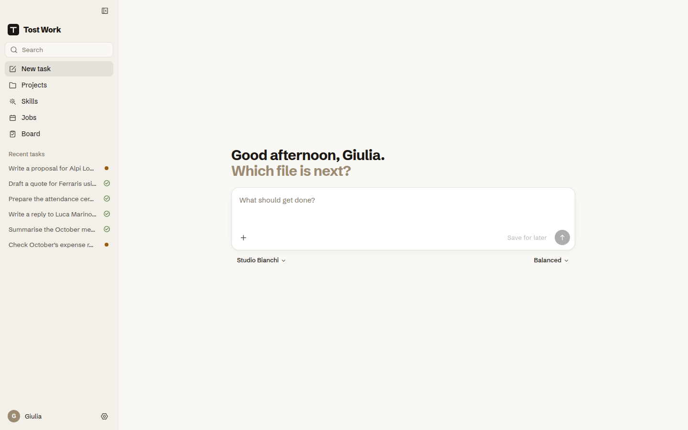
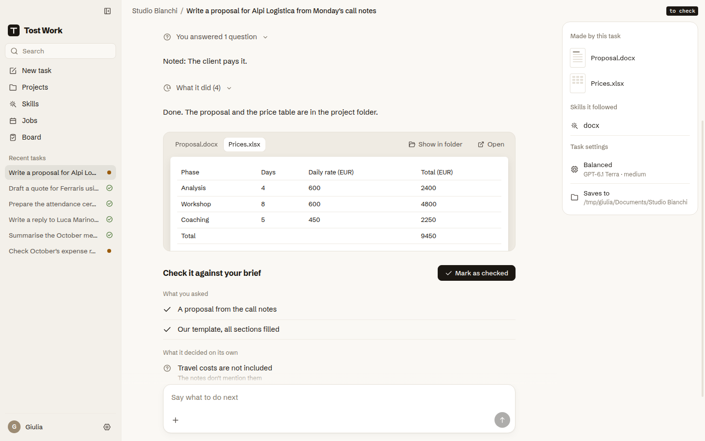
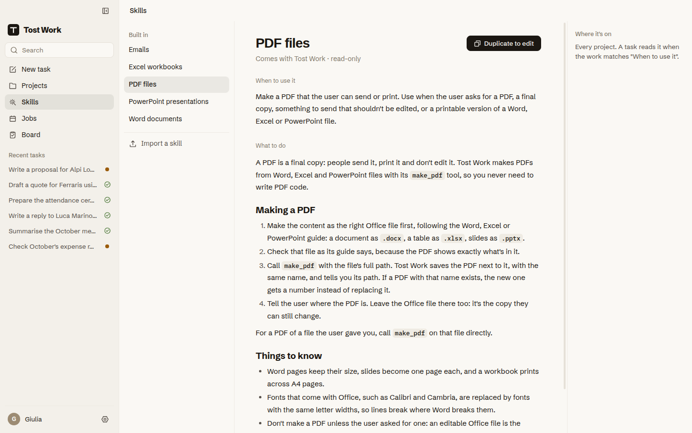

<p align="center">
  
</p>

<h1 align="center">Tost Work</h1>

<p align="center">
  A desktop app for doing everyday work with AI, on your own files.<br>
  Pick a project folder and say what you need. The AI does it there, asks when it isn't sure, and shows you every file it changed.
</p>

<p align="center">
  <a href="https://github.com/SuperTost100/tost-work/releases"></a>
  <a href="https://github.com/SuperTost100/tost-work/actions/workflows/ci.yml"></a>
  <a href="LICENSE"></a>
</p>

<p align="center">
  <a href="#install">Download</a> ·
  <a href="CONTRIBUTING.md">Contributing</a> ·
  <a href="SECURITY.md">Security</a>
</p>

<picture>
  <source media="(prefers-color-scheme: dark)" srcset="docs/screenshots/home-dark.png">
  
</picture>

## Why Tost Work

ChatGPT and Claude can already do real work on documents, spreadsheets and presentations, but their work modes change often and expect you to think like a programmer. Tost Work puts that work in a plain desktop app: every task happens inside a project folder, the result is a Word, Excel or PowerPoint file you can open, and nothing is overwritten or deleted without asking.

Tost Work has no account and no server of its own. It runs the official Codex CLI and Claude Code on your computer, signed in to your own ChatGPT or Claude subscription, or with an OpenAI or Anthropic API key. Tasks count against your plan or your key. Tost Work is free.

The app is in Italian and English, with light and dark themes. It's in alpha: Mac builds come first, and Windows and Linux follow before 0.1.0.

## What you can do

**Work in a project.** A project is a folder you already use, such as client proposals. Write what you need and attach files. The AI makes and changes files in that folder only, and it also reads your attachments, your skills and the built-in guides to do the work. It saves Word, Excel, PowerPoint and PDF files where they fit, and answers in the chat when you asked a question.

**Answer its questions.** When the AI needs a decision, it asks up to 16 questions at once, each with ready answers and room for your own, and keeps going when you reply.

**Check what changed.** Every task ends with the files it made or changed, a preview of each one, and a check against what you asked. A replaced file keeps its previous version, which you can restore with one click. Deleted files go to the system Trash.

**Edit one file quickly.** Drop a file and say what to change. The work happens in a temporary folder, and you choose where to save the result.

**Teach it your way of working.** Skills are written instructions the AI follows, such as how your company writes quotes. Write them in a formatted editor, import them from a folder or a `.zip`, or start from the built-in guides for Word, Excel, PowerPoint, PDF and email. Each skill keeps its versions.

**Schedule work.** Jobs run a request on a schedule, such as a weekly summary of new files. Tost Work stays in the menu bar so they run on time, and a run missed while the computer was off happens once when it's back.

**See everything on one board.** The Board lists every task: what needs you, what's working, what's saved for later and what's done.

**Choose how much to see.** Setup asks how you use AI today, from Beginner to Expert, and shows the sections that fit. Every section can be turned on or off in Settings. Each task says which model it uses, and you can pick Fast, Balanced or Thorough, or a specific model.

<table>
  <tr>
    <td width="50%">
      <picture>
        <source media="(prefers-color-scheme: dark)" srcset="docs/screenshots/task-dark.png">
        
      </picture>
    </td>
    <td width="50%">
      <picture>
        <source media="(prefers-color-scheme: dark)" srcset="docs/screenshots/skills-dark.png">
        
      </picture>
    </td>
  </tr>
  <tr>
    <td>A finished task: the files it made, a preview, and a check against what you asked.</td>
    <td>Skills: the built-in guides, and the ones you write or import.</td>
  </tr>
</table>

## Install

Download the file for your Mac from the [releases page](https://github.com/SuperTost100/tost-work/releases). Every build so far is a pre-release for testing.

| Mac | File |
| --- | --- |
| Apple silicon (M1 and later) | `Tost.Work-<version>-arm64.dmg` |
| Intel | `Tost.Work-<version>.dmg` |

The app isn't signed with an Apple Developer ID yet, so macOS blocks the first launch. Open the `.dmg`, drag Tost Work to Applications and open it once. Then go to System Settings > Privacy & Security, scroll to the message about Tost Work and choose Open Anyway.

Tost Work doesn't update itself yet. Until 0.1.0, download each new build from the releases page.

### First launch

Setup takes a few steps:

1. Your name, a few words about your work, and the language.
2. How you use AI today, which picks the sections you see.
3. An AI account: ChatGPT, Claude, or an API key. If Codex or Claude Code isn't installed, one button installs it with OpenAI's or Anthropic's own installer, and you sign in on their page.
4. Your first project folder, and whether Tost Work may send notifications.

## Your data

Everything Tost Work stores stays on your computer, in `~/Library/Application Support/Tost Work` on a Mac. Your skills are in `Documents/Tost Work/Skills`. API keys are encrypted with the system's secure storage.

These actions send something off your computer:

- **Running a task** sends your request, your attachments, the files the AI reads in the project folder, the skills it follows and your "About you" notes to OpenAI or Anthropic, through the Codex CLI or Claude Code. Their privacy policies and your account settings apply.
- **Installing Codex or Claude Code** downloads them from OpenAI or Anthropic.
- **Send feedback** opens a new GitHub issue in your browser, which is public once you post it.

Tost Work itself has no telemetry. The full list is in the [privacy notice](legal/privacy.en.md), and the [terms of use](legal/terms.en.md) cover the rest. Security problems go through [SECURITY.md](SECURITY.md).

## Build from source

You need Node 24 and pnpm (the version is pinned in `package.json`). The Mac app is built on macOS; the app itself runs on macOS, Windows and Linux.

```bash
git clone https://github.com/SuperTost100/tost-work.git
cd tost-work
pnpm install
pnpm dev                          # opens the app with live reload; the first run downloads Electron
```

`TOST_WORK_ENGINE=fake pnpm dev` replays scripted tasks instead of running an AI, to try the interface without an account.

The checks CI runs on every pull request:

```bash
pnpm lint && pnpm typecheck && pnpm test && pnpm build
```

[CONTRIBUTING.md](CONTRIBUTING.md) explains how to send a change.

## Documentation

| Read this                               | To learn                                       |
| --------------------------------------- | ---------------------------------------------- |
| [Scope and decisions](docs/v1-scope.md) | What each version contains, and why            |
| [Stack](docs/stack.md)                  | How the app is built, and on which libraries   |
| [Design spec](mockups/design-spec.md)   | The look: colors, type, spacing and components |

## License

Tost Work is released under the [MIT license](LICENSE). The licenses of the fonts, icons and libraries it includes are listed in the app, under Settings > About > Credits and licences.
